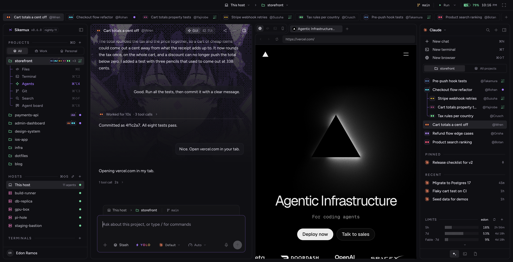

<div align="center">

# Sikemux

**自前のソフトウェア工場。**

`オープンソースのエージェント基盤 · MIT`

[English](README.md) · [简体中文](README.zh-CN.md) · 日本語 · [Türkçe](README.tr.md)

**作って届けるのはエージェント、決めるのはあなた。** プロジェクトごとのチーフが、ノートパソコンやサーバー上の Claude Code、Codex などに仕事を割り振り、スマホからも状況を追えます。共通のルール、エージェント同士のレビュー、実際のブラウザでのテスト、リリース前の確認つき。

GPU で描画する Rust 製ネイティブアプリ。約 30 MB で、すでに契約しているプランをそのまま使えます。無料・MIT ライセンスで、Apple Silicon の Mac、Windows、Linux に対応しています。



[](https://github.com/nodelike/sikemux/releases/latest)
[](LICENSE)
[](https://discord.gg/UKfmHpF9kX)
[](https://sikemux.com/ja?utm_source=github&utm_medium=readme&utm_content=ja)
[](https://docs.sikemux.com)

[sikemux.com](https://sikemux.com/ja?utm_source=github&utm_medium=readme&utm_content=ja) · [ドキュメント](https://docs.sikemux.com) · [Discord](https://discord.gg/UKfmHpF9kX) · [X (@sikemux)](https://x.com/sikemux) · [App Store](https://apps.apple.com/app/sikemux/id6819588876)

</div>

## インストール

```bash
curl -fsSL https://sikemux.com/install | sh
```

Mac なら Homebrew でも入れられます。

```bash
brew install --cask nodelike/tap/sikemux
```

Windows では [Scoop](https://scoop.sh) が使えます。

```powershell
scoop bucket add sikemux https://github.com/nodelike/scoop-bucket
scoop install sikemux/sikemux
```

画面のないサーバーには、コアだけを入れられます。

```bash
curl -fsSL https://sikemux.com/install | sh -s -- --host
```

対応環境は Apple Silicon の macOS 11 以降、x64 と arm64 の Windows 10 22H2 以降、x86_64 と arm64 の Linux です。`.dmg`、Windows 用の `.exe` インストーラー、`.deb`、AppImage は [Releases](https://github.com/nodelike/sikemux/releases/latest) からもダウンロードできます。

## 日本語で使う

Sikemux の画面は日本語に切り替えられます。Settings（設定）→ General（一般）→ Language（言語）で「日本語」を選んでください。エージェントが書いた内容はそのままで、翻訳されません。

## Sikemux を選ぶ理由

- **すべてのエージェントを並べて。** Claude、Codex、OpenCode、Hermes、Pi、Muse を同時にいくつでも。それぞれが自分のブラウザタブを持ちます。
- **Claude の上限に達したら？** そのチャットは Codex で続けられます。
- **エージェントがあなたの作業を見られる。** `@` でエージェント、`#` で issue、`!` で PR、`+` でファイル、`&` でスタッシュの中身を渡せます。ターミナルで選択したテキストやログもそのまま渡せます。チャットごとに専用の worktree も用意できます。
- **いつものツールが最初からつながっている。** GitHub、GitLab、Jira、Linear、Slack、Vercel、AWS、そしてあなたのデータベース。一度サインインすれば、どのエージェントも使えます。
- **アプリを閉じても止まらない。** ターミナル、エージェント、プロセスは動き続け、戻ってきたときには元の場所にあります。
- **どのマシンでも。** チャットとターミナルは、あなたのアカウントにあるどのホストでも動かせます。SSH ホストもワンクリックでホストにできます。
- **本物のエディタつき。** コードエディタ、ターミナル、Git、検索、そして 450 種類以上のテーマ。

## 無料ですか？

はい。Sikemux は無料で MIT ライセンスです。自分のパソコンで使うだけならアカウントも要りません。すでに支払っている Claude Code や Codex などのサブスクリプションをそのまま使い、何も契約していなければ無料のモデルも使えます。私たちはモデルを再販せず、手数料も取りません。

**どうやって続けていくの？** 今のところ売っているものはありません。Sikemux は、毎日一日中これを使っている人たちが作っています。将来お金をいただくとしたら、私たちに運用コストがかかるもの、たとえばエージェント用にこちらでホストするマシン、パソコン間の同期、チーム向けの機能です。ダウンロードするアプリは無料で MIT のままで、ライセンスがある以上、誰にも（私たち自身にも）それを取り消すことはできません。

## ソースからビルド

[Rust](https://www.rust-lang.org/tools/install)、Node.js 22 以降、[pnpm](https://pnpm.io/) が必要です。

```bash
git clone git@github.com:nodelike/sikemux.git && cd sikemux
pnpm install
make dev     # Sikemux Dev。インストール済みのアプリと並べて動きます
```

構成とチェックの方法は [CONTRIBUTING.md](CONTRIBUTING.md) を見てください。

## このドキュメントについて

この README は英語版から翻訳したもので、内容は [英語版](README.md) が正です。わかりにくい表現があれば、issue で教えてください。

## ライセンス

[MIT](LICENSE) © nodelike。「Sikemux」の名称とロゴは nodelike の商標です。
