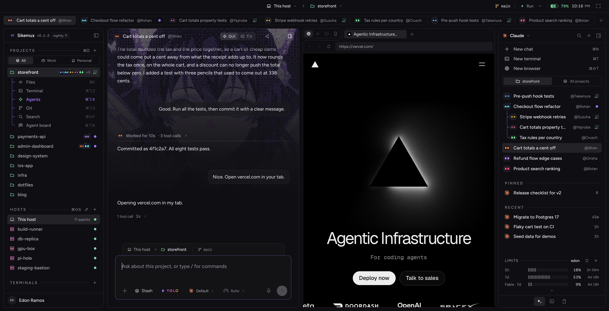

<div align="center">

# Sikemux

**The IDE for you and your coding agents.**

Bring Claude Code, Codex or OpenCode. Sikemux gives them your shell, browser, logs and deploys, in one 25 MB native app.



[](https://github.com/nodelike/sikemux/releases/latest)
[](https://discord.gg/UKfmHpF9kX)
[](https://sikemux.com)
[](https://docs.sikemux.com)

</div>

## Install

```bash
curl -fsSL https://sikemux.com/install | sh
```

On a headless server, install just the core:

```bash
curl -fsSL https://sikemux.com/install | sh -s -- --host
```

macOS 11+ on Apple Silicon, or Linux on x86_64 and arm64. The `.dmg`, `.deb`, `.rpm`, Arch package and AppImage are also on [Releases](https://github.com/nodelike/sikemux/releases/latest).

## Why Sikemux

- **Every agent, side by side.** Claude, Codex, OpenCode, Hermes and Pi, several at once, each with its own browser tabs.
- **Agents that see your work.** `@` a file, `#` an issue or PR, hand over a terminal selection or a log. Give a chat its own worktree.
- **Your tools, already wired.** GitHub, GitLab, Jira, Linear, Slack, Vercel, AWS, your databases. Sign in once; every agent can use them.
- **Nothing stops when you quit.** Terminals, agents and processes keep running and come back where you left them.
- **Any machine.** Run chats and terminals on any host on your account. Turn an SSH host into one in a click.
- **A real editor around it.** Code editor, terminals, Git and search, with 450+ themes.

## Build from source

Needs [Rust](https://www.rust-lang.org/tools/install), Node.js 22+ and [pnpm](https://pnpm.io/).

```bash
git clone git@github.com:nodelike/sikemux.git && cd sikemux
pnpm install
make dev     # Sikemux Dev, beside the installed app
```

See [CONTRIBUTING.md](CONTRIBUTING.md) for the layout and checks.

## License

[FSL-1.1-MIT](LICENSE) © nodelike. Free to use, modify and self-host; not to resell as a competing product. Each release becomes MIT after two years. "Sikemux" and its logo are trademarks of nodelike.
