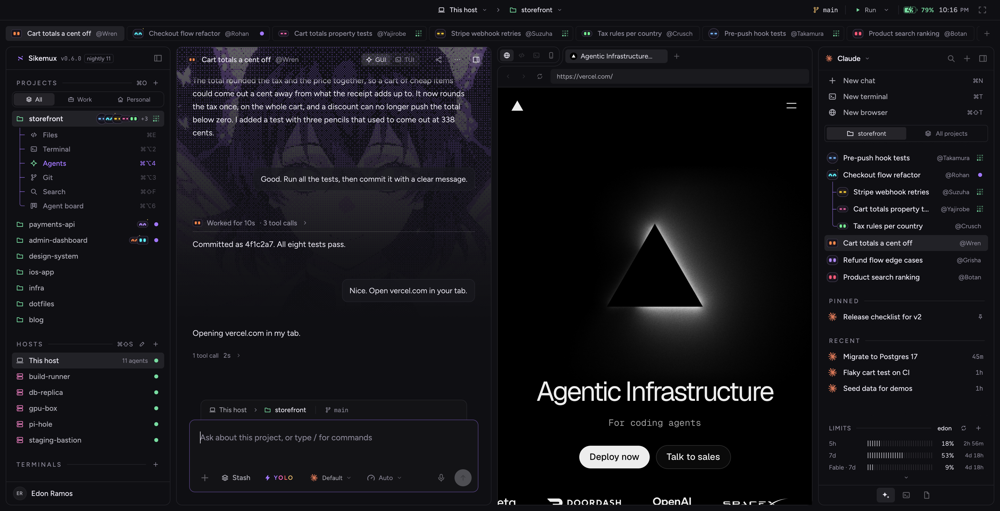

<div align="center">

# Sikemux

**Yazılım fabrikanıza kendiniz sahip olun.**

`Açık kaynaklı ajan altyapısı · MIT`

[English](README.md) · [简体中文](README.zh-CN.md) · [日本語](README.ja.md) · Türkçe

**Ajanlar geliştirir ve yayınlar. Kararları siz verirsiniz.** Bir proje şefi; paylaşılan kurallar, akran incelemesi, gerçek tarayıcı testleri ve sürüm kapılarıyla Claude Code, Codex ve daha fazlasını dizüstü bilgisayarlarınız, sunucularınız ve telefonunuz arasında görevlendirir ve yönlendirir.

GPU üzerinde çalışan, yaklaşık 30 MB boyutunda, hâlihazırda ödediğiniz planları kullanan yerel Rust uygulaması. Apple Silicon Mac'ler, Windows ve Linux için ücretsiz ve MIT lisanslıdır.



[](https://github.com/nodelike/sikemux/releases/latest)
[](LICENSE)
[](https://discord.gg/UKfmHpF9kX)
[](https://sikemux.com/?utm_source=github&utm_medium=readme)
[](https://docs.sikemux.com)

[sikemux.com](https://sikemux.com/?utm_source=github&utm_medium=readme) · [Belgeler](https://docs.sikemux.com) · [Discord](https://discord.gg/UKfmHpF9kX) · [X (@sikemux)](https://x.com/sikemux) · [App Store](https://apps.apple.com/app/sikemux/id6819588876)

</div>

## Kurulum

```bash
curl -fsSL https://sikemux.com/install | sh
```

Veya Mac'te Homebrew ile:

```bash
brew install --cask nodelike/tap/sikemux
```

Windows'ta [Scoop](https://scoop.sh) ile:

```powershell
scoop bucket add sikemux https://github.com/nodelike/scoop-bucket
scoop install sikemux/sikemux
```

Başsız (headless) bir sunucuda yalnızca çekirdeği kurun:

```bash
curl -fsSL https://sikemux.com/install | sh -s -- --host
```

Apple Silicon üzerinde macOS 11+, x64 ve arm64 üzerinde Windows 10 22H2+ veya x86_64 ve arm64 üzerinde Linux. `.dmg`, Windows `.exe` yükleyicileri, `.deb` ve AppImage paketleri de [Releases](https://github.com/nodelike/sikemux/releases/latest) sayfasında yer alır.

## Neden Sikemux

- **Her ajan yan yana.** Claude, Codex, OpenCode, Hermes, Pi ve Muse; birden fazlası aynı anda ve her biri kendi tarayıcı sekmeleriyle.
- **Claude kotanız mı bitti?** Sohbet Codex'te devam eder.
- **Çalışmanızı gören ajanlar.** `@` ile bir ajan, `#` ile bir sorun (issue), `!` ile bir PR, `+` ile bir dosya, `&` ile stash'ten bir öğe ekleyin; bir terminal seçimini veya günlüğü aktarın. Sohbete kendi worktree'sini verin.
- **Araçlarınız zaten bağlı.** GitHub, GitLab, Jira, Linear, Slack, Vercel, AWS ve veritabanlarınız. Bir kez oturum açın; her ajan bunları kullanabilir.
- **Siz çıktığınızda hiçbir şey durmaz.** Terminaller, ajanlar ve işlemler çalışmaya devam eder ve kaldığınız yerden geri gelir.
- **Herhangi bir makine.** Hesabınızdaki herhangi bir ana bilgisayarda sohbetler ve terminaller çalıştırın. Bir SSH ana bilgisayarını tek tıkla bunlardan birine dönüştürün.
- **Etrafında gerçek bir düzenleyici.** 450'den fazla temayla kod düzenleyici, terminaller, Git ve arama.

## Ücretsiz mi?

Evet. Sikemux ücretsiz ve MIT lisanslıdır; kendi bilgisayarınızda herhangi bir hesap gerektirmez. Hâlihazırda ödediğiniz Claude Code, Codex ve diğer abonelikleri veya hiç aboneliğiniz yoksa ücretsiz modelleri çalıştırır. Modelleri yeniden satmıyoruz veya komisyon almıyoruz.

**Nasıl ayakta kalıyor?** Bugün satılık hiçbir şey yok. Sikemux, onu tüm gün kullanan kişiler tarafından geliştiriliyor. Daha sonra ücretlendirme yaparsak bu yalnızca ajanlarınız için barındırdığımız bir makine, bilgisayarlarınız arasında senkronizasyon ve ekip özellikleri gibi bize çalıştırma maliyeti çıkaran şeyler için olacaktır. İndirdiğiniz uygulama ücretsiz ve MIT lisanslı kalır; lisans, biz dâhil hiç kimsenin bunu geri alamayacağı anlamına gelir.

## Kaynaktan derleme

[Rust](https://www.rust-lang.org/tools/install), Node.js 22+ ve [pnpm](https://pnpm.io/) gerektirir.

```bash
git clone git@github.com:nodelike/sikemux.git && cd sikemux
pnpm install
make dev     # Sikemux Dev, kurulu uygulamanın yanında
```

Dizin yapısı ve kontroller için [CONTRIBUTING.md](CONTRIBUTING.md) dosyasına bakın.

## Bu belge hakkında

Bu README İngilizce sürümden çevrilmiştir; esas alınacak metin [İngilizce sürümdür](README.md).

## Lisans

[MIT](LICENSE) © nodelike. "Sikemux" ve logosu nodelike'ın ticari markalarıdır.
