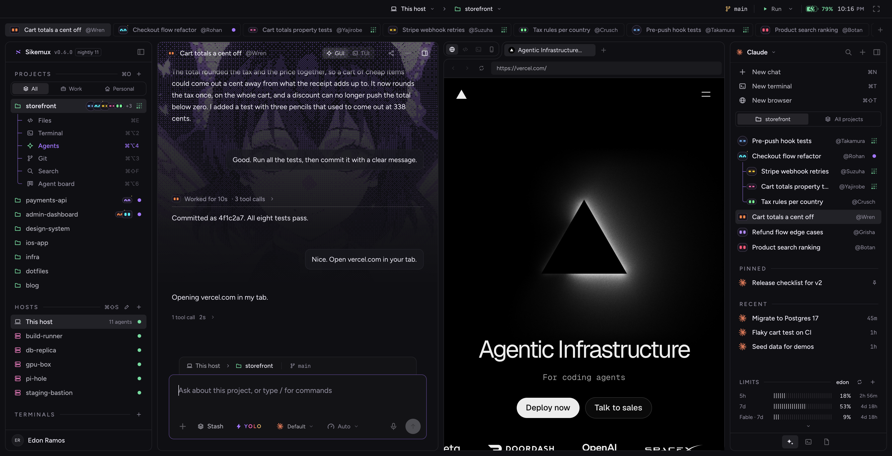

<div align="center">

# Sikemux

**你自己的软件工厂。**

`开源智能体基础设施 · MIT`

[English](README.md) · 简体中文 · [日本語](README.ja.md) · [Türkçe](README.tr.md)

**智能体开发并交付，你来拍板。** 每个项目都有一位 Chief，把活派给笔记本和服务器上的 Claude Code、Codex 等编程智能体，你在手机上也能随时跟进。规则共用，互相审阅，在真实浏览器里测试，发布也有把关。

GPU 渲染的 Rust 原生应用，约 30 MB，直接用你已在付费的订阅。免费、MIT 开源，支持 Apple Silicon Mac、Windows 和 Linux。



[](https://github.com/nodelike/sikemux/releases/latest)
[](LICENSE)
[](https://discord.gg/UKfmHpF9kX)
[](https://sikemux.com/zh?utm_source=github&utm_medium=readme&utm_content=zh-CN)
[](https://docs.sikemux.com)

[sikemux.com](https://sikemux.com/zh?utm_source=github&utm_medium=readme&utm_content=zh-CN) · [文档](https://docs.sikemux.com) · [Discord](https://discord.gg/UKfmHpF9kX) · [X (@sikemux)](https://x.com/sikemux) · [App Store](https://apps.apple.com/app/sikemux/id6819588876)

</div>

## 安装

```bash
curl -fsSL https://sikemux.com/install | sh
```

Mac 上也可以用 Homebrew：

```bash
brew install --cask nodelike/tap/sikemux
```

Windows 上可以用 [Scoop](https://scoop.sh)：

```powershell
scoop bucket add sikemux https://github.com/nodelike/scoop-bucket
scoop install sikemux/sikemux
```

在没有图形界面的服务器上，只装核心服务：

```bash
curl -fsSL https://sikemux.com/install | sh -s -- --host
```

支持 macOS 11 及以上（Apple Silicon）、x64 和 arm64 的 Windows 10 22H2 及以上，以及 x86_64 和 arm64 的 Linux。`.dmg`、Windows 的 `.exe` 安装包、`.deb` 和 AppImage 也可以在 [Releases](https://github.com/nodelike/sikemux/releases/latest) 页面下载。

## 切换成中文界面

Sikemux 的界面有简体中文：打开 Settings（设置）→ General（通用）→ Language（语言），选择「简体中文」。智能体写的内容保持原样，不会被翻译。

## 国内编程套餐

在设置的「编程套餐」页填入密钥，智能体就能用上国内的编程套餐：智谱 GLM Coding Plan、Kimi Code、MiniMax M Plan、阿里云百炼 Coding Plan、火山方舟 Coding Plan、小米 MiMo Token Plan、阶跃星辰 Step Plan、腾讯云 Coding Plan。按量计费的 DeepSeek、Moonshot 等 API 也可以接入。每家怎么配置、走不走代理，见文档 [在 Sikemux 里用国内编程套餐](https://docs.sikemux.com/zh/model-plans)。

## 为什么选 Sikemux

- **所有智能体并排工作。** Claude、Codex、OpenCode、Hermes、Pi 和 Muse，可以同时开好几个，每个都有自己的浏览器标签页。
- **Claude 额度用完了？** 这段对话可以直接在 Codex 里继续。
- **智能体看得到你的工作。** 用 `@` 提到一个智能体，`#` 一个 issue，`!` 一个 PR，`+` 一个文件，`&` 暂存区里的内容，也可以把终端里选中的文字或一段日志直接交给它。还可以给一段对话单独开一个 worktree。
- **你的工具已经接好。** GitHub、GitLab、Jira、Linear、Slack、Vercel、AWS 和你的数据库。登录一次，所有智能体都能用。
- **退出应用也不会中断。** 终端、智能体和进程会继续运行，回来时还在原来的位置。
- **任何一台机器。** 对话和终端可以跑在你账号下的任何一台主机上。一个 SSH 主机，点一下就能变成其中之一。
- **一个真正的编辑器。** 代码编辑器、终端、Git 和搜索，外加 450 多套主题。

## 免费吗？

免费。Sikemux 是 MIT 开源软件，在你自己的电脑上使用不需要注册账号。它用的是你已经在付费的 Claude Code、Codex 等订阅；没有订阅的话，也可以用免费模型。我们不转售模型，也不抽成。

**那它靠什么活下去？** 目前没有任何收费项目。做 Sikemux 的人自己每天都在用它。将来如果收费，收的会是需要我们花钱运行的东西，比如替你的智能体托管的机器、多台电脑之间的同步，以及团队功能。你下载的应用会一直免费、MIT 开源，许可证保证了谁都收不回去，包括我们自己。

## 从源码构建

需要 [Rust](https://www.rust-lang.org/tools/install)、Node.js 22 及以上和 [pnpm](https://pnpm.io/)。

```bash
git clone git@github.com:nodelike/sikemux.git && cd sikemux
pnpm install
make dev     # Sikemux Dev，和已安装的应用并存
```

目录结构和检查方式见 [CONTRIBUTING.md](CONTRIBUTING.md)。

## 关于这份文档

这份 README 由英文版翻译而来，以 [英文版](README.md) 为准。读起来有不通顺的地方，欢迎提 issue 指出。

## 许可证

[MIT](LICENSE) © nodelike。“Sikemux” 名称及其标志是 nodelike 的商标。
